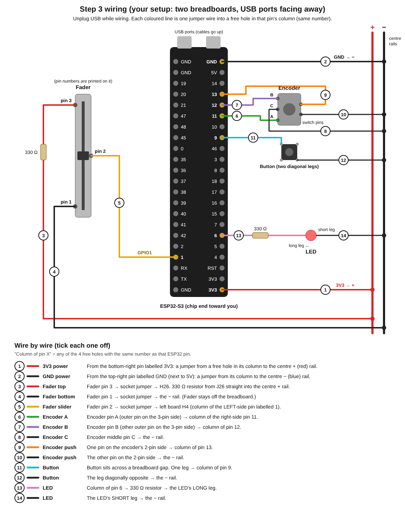

# Step 3: one of each control

Wire one fader, one encoder, one button and one LED on the breadboard, upload the sketch, and link them in FL Studio. Unplug the board from USB while you wire.

## Placing the board

Your ESP32 is 1 inch wide, too wide for one breadboard. Use **two breadboards side by side** with the ESP32 across the join: one line of pins goes in letter J of the left board, the other in letter A of the right board. Every pin then has 4 free holes beside it.

- Power: the rails under the ESP32 are covered, so use the centre rails (between the two boards, past the end of the ESP32). Jumper the 3V3 pin's column to the centre **+** rail and the GND pin's column (next to 5V) to the centre **−** rail.
- Parts go on the right board below the ESP32.
- The diagram below is drawn the way your board sits: USB ports facing away, chip end toward you.

## Wiring

"Column of pin X" means any of the 4 free holes with the same number as that ESP32 pin, on the same side of the gap. Holes with the same number on the same side of the centre gap are connected. Tick each wire off as you go.

- [ ] **1. 3V3 power:** from the bottom-right pin labelled **3V3**, a jumper from a free hole in its column to the centre **+** (red) rail.
- [ ] **2. GND power:** from the top-right pin labelled **GND** (next to 5V), a jumper from its column to the centre **−** (blue) rail.
- [ ] **3. Fader top:** fader pin **3** → **330 Ω** resistor → the centre **+** rail.
- [ ] **4. Fader bottom:** fader pin **1** → the **−** rail.
- [ ] **5. Fader slider:** fader pin **2** → column of the **left-side** pin labelled **1**.
- [ ] **6. Encoder A:** encoder pin A (outer pin on the 3-pin side) → column of pin **11**.
- [ ] **7. Encoder B:** encoder pin B (other outer pin on the 3-pin side) → column of pin **12**.
- [ ] **8. Encoder C:** encoder middle pin C → the **−** rail.
- [ ] **9. Encoder push:** one pin on the encoder's 2-pin side → column of pin **13**.
- [ ] **10. Encoder push:** the other pin on the 2-pin side → the **−** rail.
- [ ] **11. Button:** set the button across a breadboard gap. One leg → column of pin **9**.
- [ ] **12. Button:** the leg diagonally opposite → the **−** rail.
- [ ] **13. LED:** column of pin **6** → **330 Ω** resistor → the LED's **long** leg.
- [ ] **14. LED:** the LED's **short** leg → the **−** rail.

Buttons and the encoder need no resistors, because the ESP32 has them built in.

## Exact holes for your boards

Worked out from your setup: the ESP32's **3V3** pin is in **right board A1**, so its right-side pins run from **A1** (3V3) up to **A22** (GND). Its left-side pins are in **left board column J**, numbers 1 to 22. **Column numbers here are a count of holes from the end where 3V3 sits (that first hole = 1), on both sides of the gap. Don't use the numbers printed on the board:** they start at 0 on the A–E half and run backwards on the F–J half. All holes below are on the **right board** unless they say left board. The centre rails (between the two boards, past the end of the ESP32) are **+** (red line) and **−** (blue line).

| # | What | Where |
| --- | --- | --- |
| 1 | Jumper (3V3 power) | **E1** → centre **+** rail |
| 2 | Jumper (GND power) | **E22** → centre **−** rail |
| – | **Fader** | Not in the breadboard: its two side-by-side pins would land in the same column (same number) and short together. Wire it with socket-ended (female-to-male) jumpers. |
| 3 | Jumper + 330 Ω resistor | Fader **pin 3** → **H26**; resistor from **J26** straight into the centre **+** rail |
| 4 | Jumper | Fader **pin 1** → centre **−** rail |
| 5 | Jumper (fader slider → GPIO1) | Fader **pin 2** → **left board H4** (the column of the 4th pin up on the left side, labelled 1) |
| – | **Encoder** | Across the centre gap: 3-pin side in **E48, E49, E50** (middle pin in E49); 2-pin side in **I48** and **I50** |
| 6 | Jumper (encoder A → GPIO11) | **D48** → **B17** |
| 7 | Jumper (encoder B → GPIO12) | **D50** → **B18** |
| 8 | Jumper (encoder middle → GND) | **D49** → **−** rail |
| 9 | Jumper (encoder push → GPIO13) | **G48** → **C19** |
| 10 | Jumper (encoder push → GND) | **G50** → **−** rail |
| – | **Button** | Across the centre gap: legs in **E54, E56, F54, F56** |
| 11 | Jumper (button → GPIO9) | **D54** → **B15** |
| 12 | Jumper (button → GND) | **G56** → **−** rail |
| 13 | 330 Ω resistor (GPIO6 → LED) | **E6** → **F6** (it bridges the centre gap) |
| – | **LED** | **Long** leg in **G6**, **short** leg in **G7** |
| 14 | Jumper (LED → GND) | **J7** → **−** rail |

If the encoder's pins don't reach across the gap, or anything else doesn't fit, tell me and I'll move it.

## Upload

Open `step3_one_of_each.ino` (in a folder named `step3_one_of_each`). Use the same Tools settings as step 2, then plug in and upload.

## Test in FL Studio

| Control | Sends | Test |
| --- | --- | --- |
| Fader | CC 20 | Right-click a mixer track's volume fader, choose **Link to controller**, move your fader. The link window closes and FL's fader follows yours. |
| Encoder | CC 21 | Do the same with a mixer track's pan knob, then turn the encoder. |
| Encoder push | note 60 | The LED lights while pressed, and FL plays a note. |
| Button | note 61 | The LED lights while pressed, and FL plays a note. |

**Done when:** all four do what the table says. Tell me how each one behaved.

## If something's off

- **Fader doesn't change anything, or jumps between two values:** the slider pin may be numbered differently on yours. Unplug USB and swap which fader pin goes to GPIO1 and which goes to the resistor.
- **Fader can't reach the very top or bottom:** tell me, and I'll adjust `RAW_MIN` and `RAW_MAX`.
- **Encoder turns the wrong way:** swap the GPIO11 and GPIO12 wires.
- **Encoder moves 2 values per click, or needs 2 clicks per value:** tell me, and I'll change `STEPS_PER_DETENT`.
- **LED never lights:** turn it around (long leg toward GPIO6).
